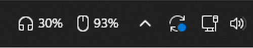

# Wireless Battery Monitor

Battery levels of your wireless mouse, headset, keyboard and controller, right on the Windows taskbar.
No vendor software, no administrator rights, no background service.

[](LICENSE)
[](https://github.com/vlad-rey/wireless-battery-monitor/releases/latest)




This is a modified version of **Wireless Battery** by krisgfx
([krisgfx9/Wireless-Device-Battery-Monitor](https://github.com/krisgfx9/Wireless-Device-Battery-Monitor), no longer
available on GitHub), based on the Simplified Chinese fork by
[fuyue521](https://github.com/fuyue521/Wireless-Device-Battery-Monitor-CN). It is not an official release of either
project. See [Changes in this fork](#changes-in-this-fork) and [CONTRIBUTORS.md](CONTRIBUTORS.md).

## Features

- **Taskbar widget**: `🎧 40%  🖱 70%  ⌨ 94%` left of the notification area, drawn with the Windows icon font.
  - **Low battery**: the number turns red at 15% or less.
  - **Charging**: a blue ⚡ next to the number.
  - **Asleep**: a sleeping device keeps showing its last known level.
  - Follows light/dark mode and DPI scaling. Two devices of the same kind get a short label (`MX`, `PRO`, ...).
- **One device at a time (optional)**: show a single device and switch with the mouse wheel over the widget.
- **Tray icons**: one icon per device with the number drawn in it, plus a "Low battery" notification. Used
  automatically when the taskbar is vertical or cannot be found.
- **Options**: brand colors, a background plate for transparent taskbars, icon above the number, which monitors
  show the widget, per-device show / hide / reorder.
- **Refresh**: every 60 seconds, and right away when a device is plugged in or the PC wakes up.
- **Languages**: English by default, with built-in translations (Arabic, Chinese, French, German, Hebrew, Japanese,
  Polish, Portuguese, Russian, Spanish, Turkish, Ukrainian). The Windows display language is used when a translation exists.
- **Tiny**: plain C++17 / Win32, no runtime, no third-party libraries.

## Supported devices

| Category | Coverage |
| --- | --- |
| Logitech | HID++ 1.0 / 2.0 mice and keyboards (Unifying, Bolt, Lightspeed, Nano, Bluetooth), G headsets, G435 |
| Razer | Mice, keyboards, dongles, BlackShark and Barracuda X headsets |
| SteelSeries, Corsair, HyperX, Astro, NZXT, Audeze, Plantronics | Mice, headsets, base stations |
| Controllers | Xbox, PlayStation DualShock 4 / DualSense, Switch Pro, Steam Controller, 8BitDo, Flydigi, Betop, GameSir |
| Earbuds and headphones | Galaxy Buds, AirPods / Beats, Jabra, JBL Quantum, MOONDROP, Sony INZONE |
| Bluetooth | Anything Windows shows a battery level for in *Settings → Bluetooth & devices* |
| Phones | Android phones linked with Microsoft Phone Link |
| Other mice and keyboards | ATK / VXE, MCHOSE, Rapoo, Kysona, Pulsar, G-Wolves, Endgame Gear, VAXEE, WLMouse, Finalmouse, LAMZU, Keychron, AULA, SONiX, Redragon / Areson, Delux / Ajazz, Rongyuan (Attack Shark and others), Xenta, DAREU, Cooler Master, Glorious, ZOWIE, Royal Kludge, ASUS ROG, and more |
| HeadsetControl | Every headset the bundled [HeadsetControl](https://github.com/Sapd/HeadsetControl) supports |

The exact models and protocols are listed in the comment at the top of each driver in [`src/drivers/`](src/drivers).
Most drivers were written from protocol documentation and other projects and could not be tested on every model.

**Tested in this fork:** AJAZZ AJ159 Apex (2.4 GHz receiver `3151:5007`), Sony WH-CH720N (Bluetooth),
Varmilo APT87 (Bluetooth LE), Xbox Wireless Controller (Bluetooth).

## Install

1. Download `WirelessBattery.exe` from the [latest release](https://github.com/vlad-rey/wireless-battery-monitor/releases/latest),
   or build it yourself (see [Build](#build)).
2. Put it in any folder, for example `%LOCALAPPDATA%\Programs\WirelessBattery`, and run it.
3. Click the widget (or tray icon) for the menu; turn on *Start with Windows* there.

Optional: put `headsetcontrol.exe` ([HeadsetControl](https://github.com/Sapd/HeadsetControl) 4.3.0) next to the exe
(or on `PATH`) for the headsets only HeadsetControl supports. Everything else works without it.

The exe is not code-signed, so SmartScreen may warn about it. Choose *More info → Run anyway*, or build it yourself.

## Command line

| Command | What it does |
| --- | --- |
| `WirelessBattery.exe --list` | Print every device and its battery level, then exit |
| `WirelessBattery.exe --dump` | Print every HID collection, USB device and Bluetooth device (also saved to `%TEMP%\WirelessBattery-dump.txt`) |
| `WirelessBattery.exe --demo` | Preview the widget with sample devices |
| `WirelessBattery.exe --quit` | Close the running instance |

## Build

Either toolchain works; there are no third-party dependencies.

**Visual Studio 2022** (the Build Tools are enough):

```bat
build_msvc.bat
```

**MinGW-w64** (for example MSYS2: `pacman -S mingw-w64-x86_64-gcc make`):

```bash
make            # or build.bat from cmd with g++ and windres on PATH
make test       # build and run the unit tests
make clean
```

Icons, the manifest and every `lang/*.txt` are compiled into the exe as resources.

### Installer

`installer\build-installer.cmd` builds `dist\WirelessBattery-Setup-<version>.exe` with
[NSIS 3](https://nsis.sourceforge.io/) (`winget install NSIS.NSIS`). It downloads HeadsetControl 4.3.0 and checks its
SHA-256 first. The installer works per user and needs no administrator rights.

### Linux (experimental)

`build-linux.sh` builds a GTK 4 tray version that reads the same receivers through hidraw. See `linux/`.

## Translations

A language is one UTF-8 text file in `lang/` with lines of `English text = translation` and named placeholders such
as `{name}` and `{percent}`. To add one, copy `lang/_template.txt`. Files in `%APPDATA%\WirelessBattery\lang`
override the built-in ones without rebuilding.

## Limitations

- **Read-only**: drivers only send battery queries; nothing is written to device settings, lighting or firmware.
- **Sleeping devices** may only report their last cached level.
- **Undocumented 2.4 GHz protocols** are not supported. For example, the Varmilo APT87 receiver (`3783:9001`) does
  not expose its battery; connect the keyboard over Bluetooth to see it.
- **Keychron keyboards** report their battery only over Bluetooth.
- **Phone Link** data comes from an undocumented file and may change with Phone Link updates.

## Contributing

Issues and pull requests are welcome, especially reports on whether your device works (most drivers are untested)
and new device protocols. Read [CONTRIBUTING.md](CONTRIBUTING.md) first: drivers must stay read-only and match
devices exactly. Use the issue templates for [bugs](https://github.com/vlad-rey/wireless-battery-monitor/issues/new?template=bug_report.yml)
and [device support](https://github.com/vlad-rey/wireless-battery-monitor/issues/new?template=device_support.yml).
Security problems go through [SECURITY.md](SECURITY.md).

**Forking** is fine and encouraged under the GPL: keep [LICENSE](LICENSE), keep the credits in
[CONTRIBUTORS.md](CONTRIBUTORS.md), say what you changed, and publish the source of any build you share.
There is no CI: run `make test` or build locally before sending a pull request.

## How it works

Each vendor driver in [`src/drivers/`](src/drivers) recognises its devices by USB vendor and product ID and only sends
read-only battery queries. The generic fallbacks (HID battery usage, Bluetooth, XInput, HeadsetControl) only look at
devices no vendor driver has claimed.

The taskbar widget is a layered child window of `Shell_TrayWnd`, placed left of the notification area. Where the
notification area is drawn by XAML (Windows 11), its real position is read through UI Automation. If Explorer
restarts, the widget is re-created.

The app makes no network connections.

## Changes in this fork

This is a modified version as described in section 5 of the GNU GPL v3. Changes made by Vladyslav Sydorov
([vlad-rey](https://github.com/vlad-rey)) in November 2026, on top of the fuyue521 fork:

- **Widget position**: on Windows 11 builds where `TrayNotifyWnd` starts right of the XAML tray, the widget covered
  the clock. It now sits left of the first tray button found through UI Automation.
- **Rongyuan receivers**: a device that went to sleep disappeared, because the receiver marks it offline. When the
  receiver still reports its level, the device stays shown as asleep (AJAZZ AJ159 Apex on `3151:5007`).
- **Bluetooth keyboards**: devices named "Varmilo ..." are always keyboards, even though their Bluetooth LE HID map
  also has a mouse collection.
- **Visual Studio build**: `build_msvc.bat`, plus small fixes so the code compiles with both MSVC and MinGW.
- **Removed**: the "Request support for a device" window (it sent data to the original author's website), the
  "Support the project" menu item, the release, Discord and pull-request automation, and the Chinese installer.
- **Defaults**: English interface unless Windows uses a language with a translation; all devices side by side
  (one-device mode is a menu option).
- **Documentation and comments** are in English.
- **Ukrainian translation** (`lang/uk.txt`).

Changes in the fuyue521 fork (November 2026): one-device mode with mouse-wheel switching and a fixed-width widget,
reviewed Simplified Chinese translation, NSIS installer.

## Credits

- **krisgfx** ([@krisgfx9](https://github.com/krisgfx9)), the original author, and the upstream contributors listed in
  [CONTRIBUTORS.md](CONTRIBUTORS.md).
- **fuyue521** ([@fuyue521](https://github.com/fuyue521)) for the fork this version is based on.
- App icon by nik-txt (`res/app.svg`, generated by `res/make_icon.py`).
- [HeadsetControl](https://github.com/Sapd/HeadsetControl) (GPL-3.0), optionally bundled; see
  [THIRD_PARTY_NOTICES.txt](installer/THIRD_PARTY_NOTICES.txt).
- The device protocols come from public research by many projects, including HeadsetControl, OpenRazer, Solaar,
  rivalcfg, OpenRGB, the Linux kernel HID drivers, SDL, BatteryTray, HaloBattery, ajazz-control-center and the vendors'
  own web configurators. Each driver names its sources in the comment at the top of the file.

## License

[GNU General Public License v3.0 or later](LICENSE). You may use, modify and redistribute this software, but anything
you distribute that is based on it must be released under the same license, together with its source code.
